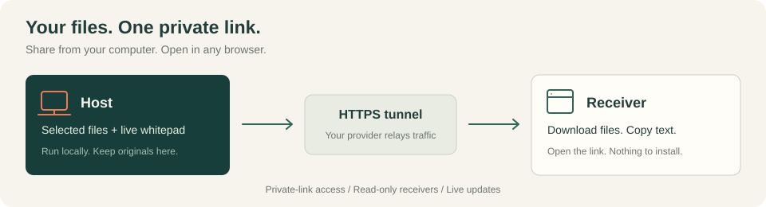
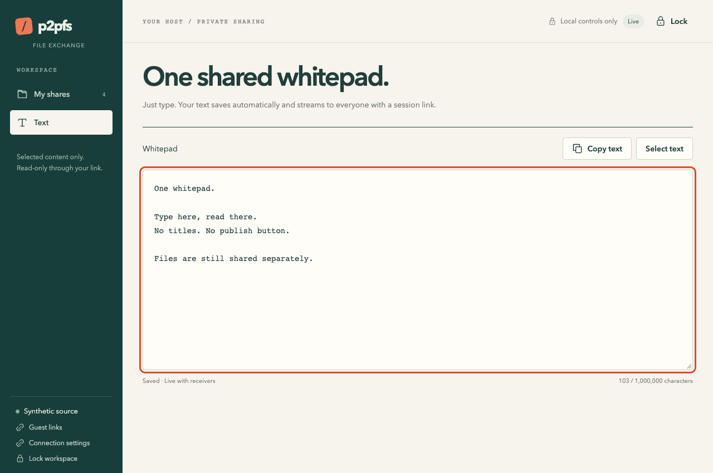
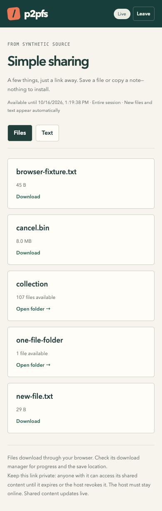
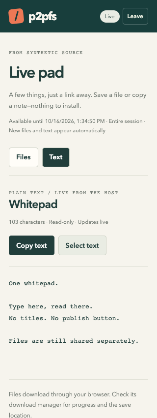

# p2pfs

Share selected files, folders, and plain text from your computer through a
private browser link.



**Host:** run the publisher locally and create a tunnel.  
**Receiver:** open the private link in a browser. Nothing to install or run.

There is no registry, peer discovery, receiver application, or central file
store. The host serves the content; the tunnel provider relays the connection.

## A look inside

**One whitepad, live.** Type on the host; receivers see updates automatically.
No titles, publish buttons, or back-and-forth.



**A browser is all they need.** Download a file, browse a folder, or copy the
whitepad from a phone or desktop.

<table>
  <tr>
    <th>Files and folders</th>
    <th>Live whitepad</th>
  </tr>
  <tr>
    <td valign="top"></td>
    <td valign="top"></td>
  </tr>
</table>

_Screenshots use demo content. No real files, passwords, or private links are shown._

## Start the host

The host needs **Node.js 24.13 or newer**, npm, and an installed, authenticated
tunnel provider. Receivers only need a modern browser.

Configure one provider using its official setup instructions:

- **ngrok** (default): install the agent and configure your account credentials.
- **Microsoft Dev Tunnels:** install `devtunnel`, then run `devtunnel user login`.
- **zrok:** install `zrok` or `zrok2`, then enable your environment with your
  provider's enable token.

The app does not install provider CLIs or create accounts.

```sh
npm ci
npm run publisher
```

Enter a **host password of at least 12 characters** at the hidden prompt. This
password protects local management; do not send it to recipients.

The command builds the app, starts the local server, and starts the configured
tunnel. Provider selection lives in the host's **`host.json`** configuration
file, not in the dashboard. Open the printed **local dashboard URL** and unlock it with
the host password. Keep the terminal running; **Ctrl+C** shuts down the host and
its app-owned tunnel.

### Configure the host

Install and authenticate your tunnel provider **before starting the publisher**.
The publisher always starts a tunnel (or verifies your externally managed one).
If no `host.json` exists, it creates one using ngrok for a new installation
or the previously selected provider for an existing installation.

To choose a provider before the first run, create `host.json` in your state
directory:

```json
{
  "provider": "ngrok"
}
```

Allowed values are `ngrok`, `devtunnel`, and `zrok`. **Restart the publisher**
after editing. The file is read at startup; dashboard start/stop buttons use
that configuration and cannot change it. Invalid configuration stops startup
with an error rather than silently choosing another provider.

For example, create `./host-state/host.json` with the contents above, then run:

```sh
npm run publisher -- --state-dir ./host-state
```

Without `--state-dir`, the app uses its per-user application-data directory and
prints the configuration path on startup. Keep provider credentials in the
provider's own CLI configuration, not in `host.json`. Do not commit the state
directory, which also holds private runtime data.

If tunnel startup fails, the publisher exits and cleans up its listeners and
app-owned tunnel processes. Fix the reported installation, login, configuration,
or quota issue, then run `npm run publisher` again. There is no local-only
startup mode or automatic failover to a different provider.

## Share content and send a link

1. In **My shares**, choose **Share something**. Select a file, share the current
   folder, or enter an absolute file/folder path in the chooser. Use **Text** to
   write in the single **Whitepad**. It saves and streams automatically as you
   type, with no title or publish button.
2. Open **Guest links**, name the session, and choose **Create session link**.
   You can create a link before sharing any content.
3. Choose **Copy session link** and send the **entire URL**, including its
   `#token=...` fragment, privately to the recipient.

A session link covers **all current and future files, folders, and text you
explicitly share from this host**. Add or remove content without issuing a new
link: recipients see changes live, without refreshing. Unshared local content
is never included.

Do not send the bare tunnel endpoint or the local dashboard URL. Only the
private receiving link grants browser access.

## Receive in a browser

Open the link. There is no account, password prompt, Node installation, tunnel
tool, or local receiver server.

- **Standalone file:** choose **Download** directly, without opening a
  one-item collection.
- **Folder:** choose **Open folder**, then download individual files. A folder
  remains browsable even if it contains only one file.
- **Text:** watch the read-only whitepad update as the host types. Choose
  **Copy text** or **Select text** to copy it.

Files stream to the browser's download manager without buffering the complete
file in JavaScript. The browser controls progress, cancellation, save location,
and filename collisions. Folder downloads are individual files, not ZIP
archives; no local folder tree or automatic synchronization is created.

The host and tunnel must stay online. Some providers display a browser
confirmation page before opening the receiving page. An interrupted download
must be restarted; resumable transfers are not implemented.

## Link access and revocation

Each link has a random 256-bit secret, **expires after 24 hours**, and can be
revoked under **Guest links**. Anyone holding or receiving a forwarded copy can
access its shared content until expiry or revocation. Treat the link like a
password.

Only a hash of the secret is stored. The complete link is shown once: copy it
before closing the dialog, or create another if you lose it. The browser
exchanges the URL fragment for a separate HttpOnly, SameSite cookie (Secure over
HTTPS), then removes the fragment from the address bar.

Revocation prevents new reads and stops active downloads through that link.
Stopping a share also blocks its new reads and cancels its active transfers.
Neither action can recall files already saved or text already copied.

Browser sessions end when the host restarts. Reopen the original link if it is
still valid and the public URL is unchanged. If the tunnel URL changes, create
and send a new link.

## Files, folders, and text

Folder shares include **nested and hidden files**, even if hidden entries were
not displayed in the file chooser. Select folders carefully. Symlinks,
redirected paths, and special files are rejected or reported as skipped.
Recipients see relative names and opaque identifiers, never absolute host paths.

Filesystem watchers update shared catalogs automatically. Deleted or unsafe
shares disappear and produce a local diagnostic. **Re-index share** remains
available if automatic watching is unavailable. A share supports up to 10,000
filesystem entries and 64 levels of nesting; folder catalog pages contain
100 files. The local chooser displays up to 1,000 directory entries; enter a
more specific path for larger directories.

There is **one plain-text whitepad** per host, shared by all session links.
Everything typed into it is automatically shared; receivers cannot edit it.
Text is displayed literally, not rendered as HTML or executed. The pad holds
up to **1,000,000 characters** (UTF-16 code units), persists across restarts, and
can be cleared by deleting its contents. Clearing also updates receivers.
There is no clipboard monitoring, chat, or edit history.

The host sends edits at a short interval while typing and shows save status.
Wait for **Saved** before closing the page. If saving fails or another host
window changes the pad, your unsaved text stays in the editor: choose **Send my
text** to replace the saved pad, or **Use saved text** to discard your edits.

The host dashboard and browser receiver use authenticated Server-Sent Events
for live updates. They reconnect automatically; file-watcher and connection
errors are shown rather than silently ignored.

## Run persistently on macOS

Use the included **LaunchAgent** to run the publisher without an open terminal.
It starts when you log in and restarts after a crash, with a 30-second retry
interval. It runs as your user, not as a system daemon.

First configure your tunnel provider and confirm `npm run publisher` works.
Then stop that publisher with **Ctrl+C** before installing the service:

```sh
npm run host-service -- install
npm run host-service -- start
```

During installation, macOS prompts for your **existing host password** and saves
it in Keychain. The installer verifies it against your existing state. It never
writes the password into the LaunchAgent, environment variables, or command-line
arguments. At startup, Keychain supplies it to the publisher through stdin.
If macOS asks for Keychain permission, allow the expected `/usr/bin/security`
access. The login keychain must be unlocked.

If your publisher uses a custom state directory, pass the same path **when
installing**:

```sh
npm run host-service -- install --state-dir ./host-state
```

Installation prepares the LaunchAgent but does not start it immediately.
`start` loads it now; otherwise it starts at your next login. Only one service
is supported per user, using the standard ports `7331` and `7332`.
Do not run a second publisher against the same state directory or ports.

```sh
npm run host-service -- status
npm run host-service -- stop
npm run host-service -- start
npm run host-service -- uninstall
```

`status` shows launchd's process state and last exit status. Check `host.log`
and `host-error.log` in the state directory's `service-logs` folder for the
dashboard URL, public endpoint, and startup errors. The installer prints the
log location. For a custom state directory:

```sh
tail -f ./host-state/service-logs/host.log ./host-state/service-logs/host-error.log
```

`stop` unloads it until you start it again or log in again. `uninstall` removes
the LaunchAgent and its Keychain password, but keeps your shares, settings,
original files, and logs. Use `stop` then `start` after code or `host.json`
changes. Logs are retained; remove old logs while the service is stopped if needed.

The installer captures your Node executable, project location, and current
`PATH` so launchd can find the configured tunnel CLI without loading shell
profiles. Keep the project and Node installation at those locations. After
moving the project or replacing Node through a version manager, uninstall and
reinstall the service. Run all commands **without sudo**.

Your Mac must stay awake and connected to the internet. This service does not
prevent sleep, run while you are logged out, or bypass provider authentication
and quotas. Restarting a tunnel may change its public URL; issue new guest links
when that happens.

## Host options

```sh
npm run publisher -- --help
npm run publisher -- --name "My host" --state-dir ./host-state
```

The public-content listener and management dashboard both bind to loopback:

| Option              | Default                                | Purpose                                           |
| ------------------- | -------------------------------------- | ------------------------------------------------- |
| `--transfer-port`   | `7331`                                 | Read-only content behind the tunnel               |
| `--management-port` | `7332`                                 | Local host dashboard; never forward this port     |
| `--state-dir`       | Per-user OS application-data directory | Publisher settings and shared-content definitions |
| `--name`            | Hostname on first start                | Display name shown to recipients                  |

Use separate state directories and ports if running multiple publishers.
For automation, `--password-stdin` reads the host password from standard input.
Connect it to your secret manager rather than writing real passwords into shell
history or command-line arguments.

### Externally managed tunnel

```sh
npm run publisher -- --public-url https://YOUR-HTTPS-ENDPOINT
```

Forward the transfer port, **not the management port**. The app verifies the
endpoint belongs to this host; your provider controls the external tunnel's
lifecycle. The dashboard labels it **Externally managed** and does not offer
start/stop controls.

Use `--allow-host custom.example.org` for additional trusted tunnel hostnames.
Public endpoint probes require HTTPS, reject private-network DNS results, pin
the validated address, and do not follow redirects.

### Provider behavior

| Provider     | Integration                                                                                                                                                       |
| ------------ | ----------------------------------------------------------------------------------------------------------------------------------------------------------------- |
| devtunnel    | Uses `host -p PORT --allow-anonymous`, checks login, parses the hosting URL, and probes the public endpoint.                                                      |
| ngrok        | Uses the existing agent configuration with a temporary app-owned inspection-port override; matches `/api/endpoints` to this host. Request inspection is disabled. |
| zrok / zrok2 | Uses a public headless, force-local share and checks the required CLI flags before starting.                                                                      |

Provider-level open access does **not** bypass private-link authentication.
Only app-owned processes are stopped. Provider switching requires editing `host.json` and restarting, not
automatic failover. Bandwidth, quotas, provider availability, and account limits
still apply.

## Persistence and upgrading

Settings, selected paths, text, and link hashes live in the host's state
directory. File contents remain at their original locations. State files use
restrictive POSIX permissions; on Windows use a protected per-user directory.
Text is stored as plaintext, not in a separate encrypted vault.

Existing publisher state is migrated on startup. Old snippets are combined
into the whitepad with their titles and text preserved. Shares, password
verifier, identity, provider settings, and valid links are preserved.
Older item-specific links keep their file restrictions but **cannot access the
combined whitepad**; issue a new session link for text access. Their access is
never silently expanded.

The former installed receiver, registry/discovery, and CLI share/download
commands have been removed. Obsolete settings are dropped from the migrated
state, but old downloaded files and registry databases are **not deleted**.
Use the host dashboard for management and browser links for receiving.
Back up the state directory before upgrading; the new state format is not
readable by older app versions. Restart the publisher manually after updating.

## Security and availability

The public listener exposes only read-only guest access, its page/assets, and a
minimal health probe. Local management remains on its separate loopback port
with password authentication, Host/Origin checks, and CSRF protection. A guest
cookie cannot manage the host.

This is **not relay-free or end-to-end encrypted against the tunnel provider**.
Providers relay traffic and may terminate TLS. Trust the provider with content
and traffic it can observe. Links are bearer access, not individual-user
permissions.

Source metadata is checked before/during streaming; cryptographic file-content
verification is not implemented. Local filesystem mutation by a privileged
local process is outside the remote threat model. Do not place share or state
roots in directories controlled by untrusted local users.

Capacity limits and throttling reduce abuse but cannot guarantee availability
against denial of service. There is no remote upload, synchronization, or
production high-availability guarantee.

## Development and verification

```sh
npm run check
```

This runs strict type checking, ESLint, formatting checks, compilation, and
automated tests. Coverage includes host startup/shutdown, state migration,
management isolation, file safety and streaming, browser-link permissions,
expiry/revocation, live updates, text persistence, and tunnel process handling.
Test-only loopback access is injected in fixtures and is not a production CLI
option. GitHub Actions is configured for macOS, Linux, and Windows; a local
passing run is not proof that all platforms have passed.

Optional credential-gated public-provider smoke tests:

```sh
npm run build
node dist/test/live-provider.js ngrok
node dist/test/live-provider.js devtunnel
node dist/test/live-provider.js zrok
```

These publish only synthetic content, exercise the guest session/download APIs
through a real tunnel, check revocation and management isolation, and clean up
their own host and tunnel. They need an available provider account and tunnel
capacity. They do not prove browser interstitial handling or cross-platform
success. Desktop/mobile browser checks are separate from these API smoke tests.
